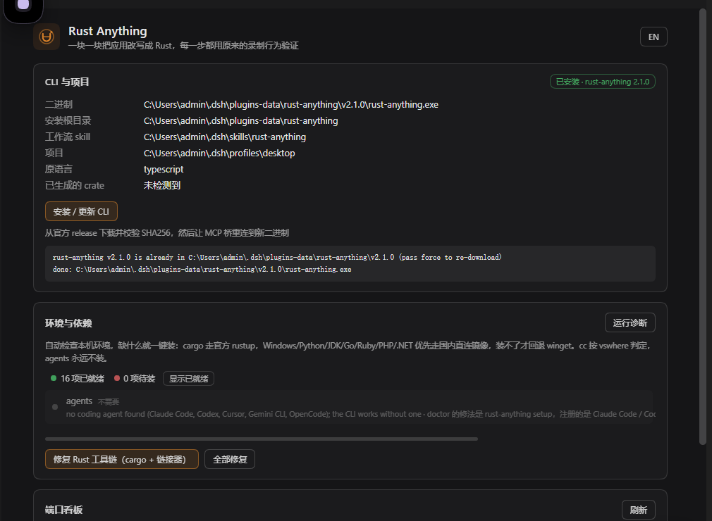
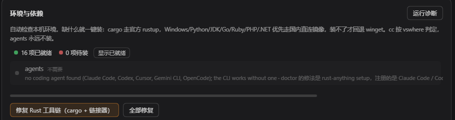

[](https://github.com/L1daye/dsh-rust-anything/actions/workflows/test.yml)

把 [rust-anything](https://github.com/erkamyaman/rust-anything) 接进 DeepSeek Harness：**16 个 MCP 工具** + **4 个 `ra_*` 工具** + 一块移植看板 + 一个环境安装器。

> **状态：`0.1.0-beta.1`，仅 Windows，只在 DSH `0.2.2-rc.3` 上验证过。** 兼容矩阵见下。



## 它解决什么问题

Harness 里没有 rust-anything 的原生集成，手工加 MCP server 也容易踩坑：pnpm 装出来的 profile 常常不带 `@deepseek-ai/dsh-mcp-client`，照文档写一行 `name: '@deepseek-ai/dsh-mcp-client'` 会直接解析失败。

这个插件**自带一个 minimal MCP stdio 客户端**（零 peer dependency），把 CLI 的工具注册成 `mcp__rust_anything__*`，并额外提供：

- **工具面开关**——`off` / `plan`（5）/ `port`（11）/ `all`（16），想省 context 就关掉不用的；
- **移植看板**——哪些 unit 已移植、fallback 还剩多少、录制条数、最近一次 diff；
- **环境体检 + 一键安装**——`doctor --json` 的结果按绿/黄/红点列出，缺什么装什么（cargo、MSVC、Node、Python、Go、JDK、Ruby、PHP、.NET、wasm32、wasm-bindgen、kotlinc、Android NDK…）；
- **CLI 自更新**——从官方 release 下载、校验 `SHA256SUMS`、解包，随后就地重启自己的 MCP 客户端；
- **workflow skill**——装进 `~/.dsh/skills/rust-anything`，让模型知道 analyze → bridge → record → diff → bench → gate 的顺序。

## 快速开始

要求：Windows 10/11、DeepSeek Harness ≥ `0.2.2-rc.3`、Node ≥ 20。

```powershell
git clone https://github.com/L1daye/dsh-rust-anything
cd dsh-rust-anything

pwsh -File .\install.ps1 -DryRun   # 先看它会改哪些文件
pwsh -File .\install.ps1           # 复制进 profile、登记 bundle、种工具面配置
```

然后重启 Harness。侧栏出现 **Rust Anything**，输入框左侧出现 **工具面** chip。

手工安装等价于：

1. 把本仓库复制到 `<DSH_HOME>/profiles/<profile>/node_modules/dsh-rust-anything`；
2. 在 profile 的 `package.json` 里把 `dsh-rust-anything` 加进 `dsh.profile.bundles`；
3. 重启。

> Electron 托管的 profile（例如 `desktop`）由应用独占，`dsh plugin add` 会被拒；对这种 profile 用 `install.ps1` 即可。

## 工具

| 工具 | 用途 |
|---|---|
| `ra_status` | 一次看全：CLI 路径与来源、安装根、版本、MCP 工具计数、doctor 结果、当前项目（有 `rust/` crate 就列出来） |
| `ra_cli` | 用任意参数跑本地 CLI（`doctor`、`analyze`、`record`、`gate`… 以及 MCP 面暂时没暴露的命令） |
| `ra_install` | 下载/更新 CLI（校验 SHA256），装 skill；支持 `{cancel:true}` 中止下载 |
| `ra_surface` | 切换工具面档位，或直接给 allow 白名单 |
| `ra_bootstrap` | 按 plan 装工具链：后台跑、可取消、可看日志、断点续传 |

MCP 侧 16 个工具按档位注册：`analyze` `bridge` `refresh` `profile` `map` `record` `build` `diff` `bench` `shadow` `gate` `app_record` `app_replay` `app_front_door` `app_wire` `app_lift`。

## 页面

四个卡片：**状态**（CLI/MCP/skill/版本/doctor 汇总）、**环境与依赖**（逐项绿黄红点 + 修复按钮 + 停止按钮 + 实时日志）、**移植看板**（unit 列表、fallback 比例、录制数、最近 diff）、**工具面**（档位 chip）。

## 环境安装



```
ra_bootstrap {plan:"rust"}      # 只补 Rust 工具链（cargo + 链接器）
ra_bootstrap {plan:"all"}       # 所有可装项
ra_bootstrap {ids:["Android NDK"]}
ra_bootstrap {cancel:true}      # 中止
```

- 后台执行，立刻返回前几行日志；进度写在 `<data>/bootstrap.json`，页面也会实时更新；
- 镜像策略：官方源 → 国内直连镜像（TUNA / 华为 / 阿里 / rsproxy）→ 必要时的 winget；全部 HTTPS；
- 大文件（如 NDK）**断点续传**，每 50 MB 记一行进度；
- `agents` 永不安装——它指的是给 Claude Code / Codex / Cursor 等注册 rust-anything 的说明文件，与本 Harness 无关。

## 兼容矩阵

| DSH 版本 | Windows | macOS | Linux |
|---|---|---|---|
| `0.2.2-rc.3` | ✅ 端到端验证 | ⚠️ 未验证 | ⚠️ 未验证 |
| 其他 `0.2.x` | ⚠️ 未验证 | — | — |

插件依赖若干**未公开的内部接口**（`ctx.tools.register`、`ctx.inject(['webServer'])`、`slots.register`、`window.__ModuleLoader__`、`ctx.workingDirectory`）。DSH 升级可能改变它们——升级后请先 `node tests/*.mjs`，再看 `ra_status`。

## 已知限制

- 只支持 **Windows**：`install.ps1`、`cc`/`kotlinc` 的探测、`vswhere`、计划任务式的重启都属于 Windows 路径；
- `doctor` 里 `agents` 永远是红/灰项，这是设计；
- `cordis.patch.yml` 只插入一行 host 半；如果别的插件也改同一处，需要手工合并；
- **不承诺移植一定更快**。`bench` 会按调用方真实调用方式计时（含过桥），照实给出负结论——例如 devalue 的 `stringify` 是 `0.21x`、`parse` 是 `0.42x`，都不该为性能而移植；
- 传输层是 JSON，**无法表达**共享引用、循环引用、`RegExp` / `URL` / 大多数 TypedArray，移植这些 unit 时它们会落在输入域之外。

## 安全

见 [SECURITY.md](SECURITY.md)。要点：插件会**下载并执行安装包**（官方 release + `SHA256SUMS`；工具链走 https 镜像）、管理接口用**每个进程一个随机 token + loopback 围栏**、`ra_cli` 能执行任意 CLI 参数。

## 测试

```powershell
cd dsh-rust-anything
npm test     # selftest + clienttest + hosttest（含 14 条 HTTP 路由断言）
```

三套测试不装 DSH：用假 MCP server 与桩 ctx 覆盖工具注册、工具面切换、路由鉴权、后台任务、路径规范化。

## 许可

MIT，见 [LICENSE](LICENSE)。第三方组件与致谢见 [THIRD-PARTY-NOTICES.md](THIRD-PARTY-NOTICES.md)。
